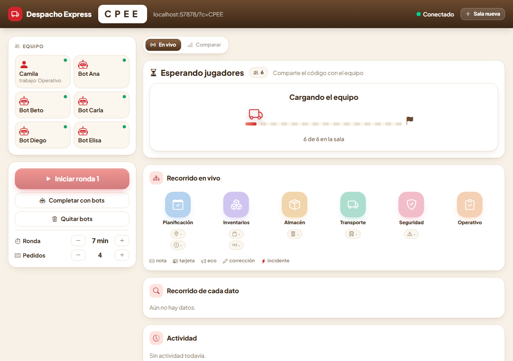
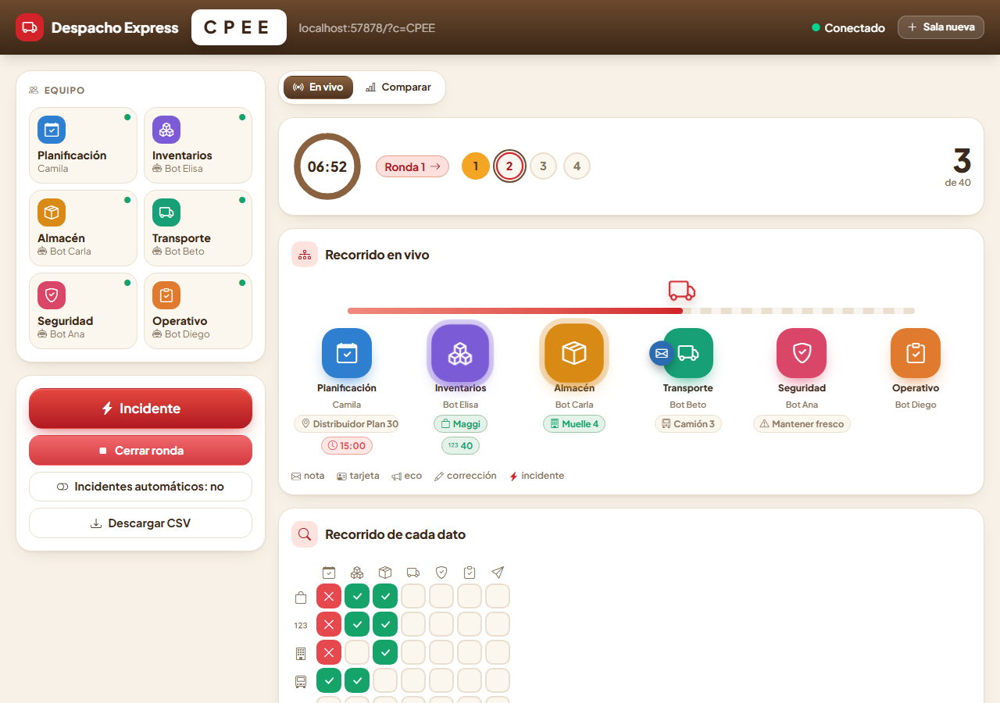
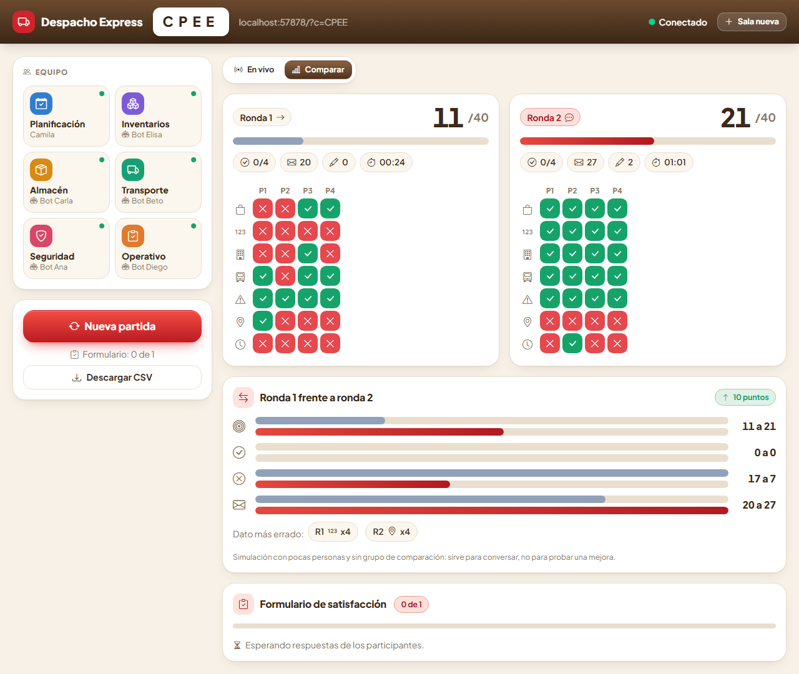
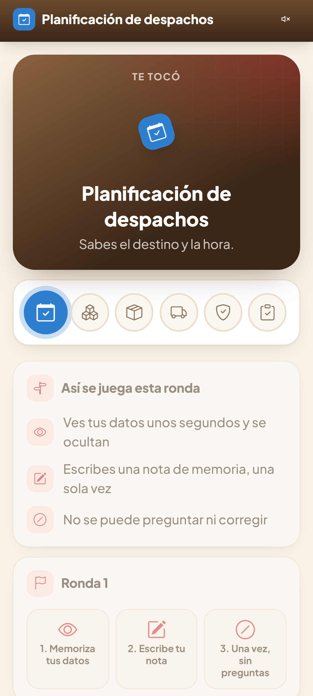
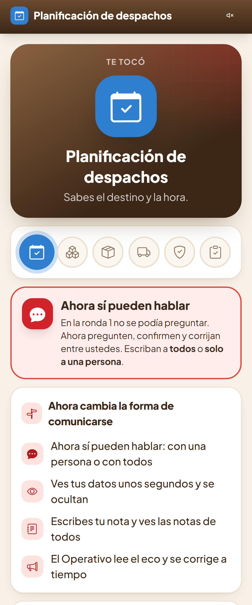
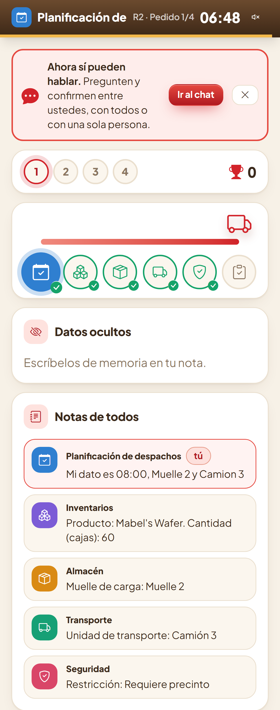
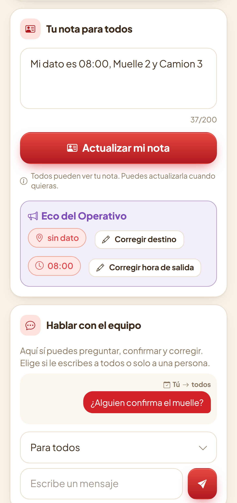

# Despacho Express: manual completo

Documento para revisión. Cubre qué es el juego, cómo se facilita, cómo se juega, cómo se publica y qué falta.

## 1. Qué es

Juego cooperativo en tiempo real para el taller de Liderazgo y Dinámica de Grupos (caso Nestlé Bolivia, área de Logística y Distribución).

- **Problema que ataca:** la comunicación entre compañeros no es fluida.
- **Idea:** seis eslabones de una cadena de despacho, cada uno sabe una parte del pedido. Si la información se pierde o cambia, el despacho sale mal.
- **Duración:** 30 minutos, 2 rondas.
- **Es la única actividad del taller**, más un formulario de satisfacción anónimo al final.

Reglas de contenido del proyecto:
- Todo en español, sin emojis (solo Bootstrap Icons), poco texto y muy visual.
- Los roles se asignan al azar y nunca coinciden con el cargo declarado del jugador.
- La comunicación es entre compañeros; no se menciona al jefe.
- Se dice "muelle", no "andén" (en pantalla; el identificador interno sigue siendo `anden`).
- Los datos son ficticios y la simulación no prueba una mejora real.

## 2. Roles y datos

| Eslabón | Datos que conoce |
|---|---|
| Planificación de despachos | destino, horario |
| Inventarios | producto, cantidad |
| Almacén | muelle |
| Transporte | unidad |
| Seguridad | restricción |
| Operativo | ninguno: arma y envía el despacho |

Con menos de 6 personas, cada una toma varios roles. Las que sobran entran como observadoras (ven la actividad, no actúan). Máximo 14 jugadores.

## 3. Las dos rondas

| Ronda | Modo | Qué cambia |
|---|---|---|
| 1 | Solo hacia adelante | Cada uno ve sus datos 8 segundos y se ocultan. Escribe de memoria una nota al siguiente eslabón, una sola vez por pedido. No se puede preguntar ni corregir. |
| 2 | Conversar y confirmar | Los datos también se ven 8 segundos. Cada dueño publica una nota que ven todos y puede hablar directo con alguien o con todos. El Operativo repite lo entendido (eco) y cada dueño corrige lo que esté mal. |

Lo que se llevan los participantes: la nota clara y compartida, la regla del eco y un compromiso personal.

## 4. Puntaje

- Cada pedido tiene 7 datos. Cada dato correcto suma 1 punto.
- Si los 7 están correctos, bonus de 3 puntos: máximo 10 por pedido.
- Por defecto: 4 pedidos por ronda y 7 minutos (420 s). Ajustable en el panel.
- **Camión:** en el panel y en el celular, un camión avanza por la ruta a medida que cada eslabón comunica su dato, llega a la meta al enviarse el despacho y sale de nuevo en el pedido siguiente. También es la pantalla de carga de la sala y del "Listo".
- **Incidentes:** cambios de último momento que alteran un dato (paro de transporte, cliente adelanta el horario, cambio de muelle, inspección de seguridad, cambio de destino, corrección de cantidad). Pueden dispararse a mano o en automático.

## 5. Guía para la facilitadora

Entrada: `https://despacho-express.onrender.com/host` (no la página principal, que es de los jugadores y pide código de sala).

**Antes del taller**
1. Abre `/host` unos minutos antes: el servicio gratis de Render se duerme y tarda cerca de un minuto en despertar.
2. Se crea la sala y aparece el **código de 4 letras**. Tocarlo copia el enlace para los jugadores.

**Durante**
1. Los jugadores entran a la página principal con el código y un apodo (no el nombre real).
2. Si faltan personas para probar, botón **Completar con bots**.
3. **Iniciar ronda 1** (se necesitan al menos 2 en la sala). Cada jugador ve su rol y toca **Listo**. La ronda arranca cuando todos los humanos conectados tocaron Listo, o cuando tú pulsas **Empezar ya**.
4. Mira el panel: recorrido en vivo de la cadena, reloj, puntos y un círculo por pedido. Tocar un rol abre su historial; tocar un círculo inspecciona ese pedido.
5. **Cerrar ronda** si hace falta terminarla antes.
6. **Iniciar ronda 2**. Al terminar, usa **Comparar** (ronda 1 frente a ronda 2) para la discusión.
7. Al finalizar, los jugadores responden el formulario anónimo.

**Después**
- Descargar el **CSV** (datos por pedido, resumen por ronda y resultados del formulario, sin nombres).
- **Nueva partida** para reiniciar.

Controles del panel: iniciar ronda, empezar ya, incidente (manual o automático), cerrar ronda, nueva partida, descargar CSV, duración y número de pedidos, completar con bots.

## 6. Guía para jugadores (celular)

1. Abrir la página principal, escribir el código y un apodo.
2. Aparece el rol ("Te tocó"), la cadena, las reglas de la ronda y tres pasos. Tocar **Listo**.
3. Durante la ronda:
   - **Ronda 1:** memorizar los datos (se ven 8 segundos), escribir una nota con ellos y lo que llegó del eslabón anterior, y enviarla. Solo se envía una vez por pedido. El Operativo lee la nota y arma el despacho.
   - **Ronda 2:** memorizar los datos, publicar la nota (la ven todos), conversar por mensajes directos o para todos, escuchar el eco y corregir si algo no coincide.
4. Al terminar el pedido, todo el equipo ve el resultado.

Durante la ronda 2 (arriba: camión, datos ocultos y notas de todos; abajo: tu nota, el eco y la conversación):

Diversión incluida:
- Resultado al instante de cada pedido (puntos, racha de perfectos, qué dato falló, sin revelar el valor real).
- Marcador con un círculo por pedido, racha y puntos.
- Camión que sigue el recorrido del pedido; al tocarlo suena la bocina.
- Paquetes que vuelan entre eslabones.
- Reloj con urgencia en el último minuto y barra de tiempo.
- Cuenta de arranque, confeti y vibración.
- **Sonido apagado por defecto**: botón de altavoz en la barra superior.
- Fin de ronda: hasta 3 estrellas e insignias. Son un juego, no una medida de mejora real.

## 7. Formulario de satisfacción (anónimo)

8 afirmaciones en escala de 1 a 5 y 3 preguntas abiertas.
- No se guarda quién respondió cada cosa; solo se registra quién ya respondió, para evitar duplicados.
- Las respuestas abiertas se muestran en orden alfabético.
- Los bots no responden.

## 8. Publicación

**Repositorio:** https://github.com/AndreSeba/DespachoExpress (rama `main`, solo el juego).

**Render** (https://despacho-express.onrender.com), configuración que debe tener el servicio:
- Build Command: `pnpm install --frozen-lockfile --prod=false && pnpm build`
- Start Command: `node server.js`
- Health Check Path: `/health`
- Node 22 (fijado en `package.json`).

Pendiente: el servicio fue creado con otro Build Command y el panel de Render es el único lugar donde se puede cambiar. Hasta que se corrija y se haga un Manual Deploy, los despliegues fallan.

Avisos del plan gratis: se duerme sin uso, las salas viven en memoria y se pierden al reiniciar, y no se guarda nada en disco (descargar el CSV al terminar).

**Local, sin internet (por WiFi):** `pnpm install`, `pnpm build` y `pnpm start`. Los celulares abren `http://IP-DE-LA-LAPTOP:3000`.

Los paquetes se instalan con `pnpm`, nunca con `npm`.

## 9. Pruebas

- `pnpm test`: lógica del juego y bots (23 pruebas).
- `node test/e2e.mjs`: panel, un jugador humano en celular y bots, con capturas (`SHOTS=/ruta`).
- `node test/demo-e2e.mjs`: la demo de un solo archivo.

## 10. Estado y pendientes

**Hecho y subido a `DespachoExpress` (commit 0defb30):**
- Interfaz nueva con React, TypeScript, Vite, Tailwind y Framer Motion (carpeta `web/`), con paleta clara cálida. El servidor y la lógica de juego se mantuvieron.
- Camión que sigue el recorrido en el panel y en el celular, y sirve de pantalla de carga.
- Ronda 1: los datos se ven 8 segundos y se ocultan; la nota se escribe a mano y se envía una sola vez por pedido.
- Ronda 2: los datos también se ocultan; notas de todos a la mano, conversación directa o para todos, y avisos claros de que ahora sí se puede hablar.
- Pantalla previa con las reglas de cada ronda y, al terminar, "Dónde se perdió información".
- Productos solo de Nestlé y Fagal (Mabel's), manual en PDF y capturas, Dockerfile en dos etapas.
- Verificado con 23 pruebas y el recorrido completo en navegador (panel, jugador y bots), sin errores. Las capturas de este manual salen de esa corrida.

**Pendiente:**
- Corregir Build Command y Health Check en Render y hacer Manual Deploy. Con la interfaz nueva, el Build Command pasa a ser `pnpm install --frozen-lockfile --prod=false && pnpm build`.
- Ensayo con 6 personas.
- Actualizar la presentación del equipo y revisar referencias del informe y el nombre de la materia en la portada.
- Opcionales: ronda de práctica guiada, vista de proyector, pausa, cuenta regresiva.
- La demo `demo/index.html` conserva el diseño viejo y no tiene los efectos nuevos.

## 11. Límites

Simulación con pocas personas y sin grupo de comparación. La nota compartida y el eco son propuestas de diseño del equipo. Los casos son ficticios. Los puntos y las estrellas no demuestran una mejora real en la comunicación.
